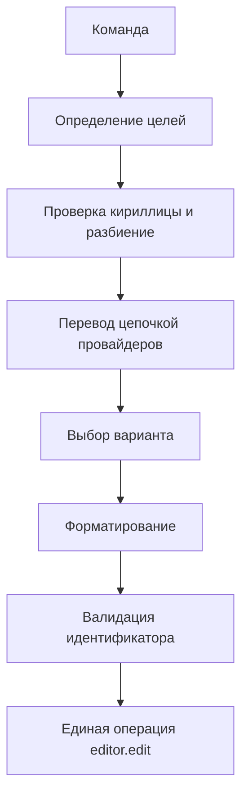

# Архитектура

Расширение активируется при вызове команд. `extension.ts` связывает Extension API с чистыми компонентами логики: `TextTargetResolver` находит диапазоны; `IdentifierSplitter` делит слова; `KindDetector` определяет предполагаемый тип; `TranslationService` последовательно вызывает реализации `TranslationProvider`; `Formatter` и `IdentifierValidator` формируют итоговое имя; `editor.edit` применяет все замены атомарно.

`MyMemoryProvider` извлекает кандидатов из `matches` и основного перевода. `GoogleProvider` служит резервом. Каждый запрос ограничен `AbortSignal.timeout`; кэширования нет. `Map` используется для реестра провайдеров, уникальных целевых диапазонов и наборов ключевых слов; `Set` хранит зарезервированные слова и устраняет дубликаты; массивы задают порядок провайдеров, слов и замен. `TranslationProvider` и `TextTarget` описывают границы модулей.

